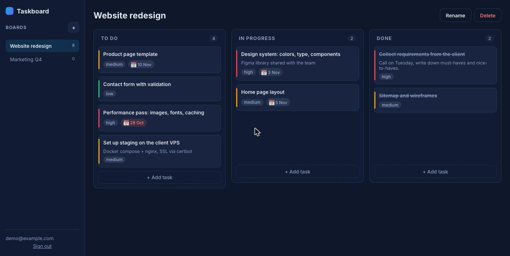

# taskboard

Kanban board with a real backend: FastAPI + SQLAlchemy + SQLite, JWT authentication, and a vanilla
JavaScript frontend with drag and drop. One container, no external services.



## Features

**API** (`/docs` has the interactive OpenAPI UI)
- Register, login with JWT bearer tokens, `GET /api/auth/me`
- Boards: list, create, rename, delete (cascade removes tasks)
- Tasks: create in a column, edit title/description/priority/due date, delete
- `POST /api/tasks/{id}/move` moves a task to another column and position, keeping positions dense
- Every object is scoped to its owner; other users get 404, never someone else's data
- 12 tests with an in-memory SQLite, CI runs lint and tests

**Frontend** (served by the same app at `/`)
- Sign in / create account, token kept in `localStorage`
- Multiple boards, inline rename, delete with confirmation
- Three columns, drag and drop between and within columns with optimistic updates
- Task dialog with priority and due date; overdue and "due soon" badges
- Responsive: columns stack on phones

## Run

```bash
cp .env.example .env            # set SECRET_KEY
docker compose up -d --build    # http://localhost:8000
```

or locally:

```bash
python -m venv .venv && source .venv/bin/activate
pip install -e ".[dev]"
uvicorn app.main:app --reload
```

## API in 30 seconds

```bash
curl -s -X POST localhost:8000/api/auth/register -H 'content-type: application/json' \
  -d '{"email":"ann@example.com","password":"correct horse"}'
TOKEN=$(curl -s -X POST localhost:8000/api/auth/login -H 'content-type: application/json' \
  -d '{"email":"ann@example.com","password":"correct horse"}' | python -c 'import sys,json;print(json.load(sys.stdin)["access_token"])')
curl -s -X POST localhost:8000/api/boards -H "authorization: Bearer $TOKEN" -H 'content-type: application/json' -d '{"name":"Launch"}'
curl -s -X POST localhost:8000/api/boards/1/tasks -H "authorization: Bearer $TOKEN" -H 'content-type: application/json' -d '{"title":"Write README","priority":"high"}'
curl -s -X POST localhost:8000/api/tasks/1/move -H "authorization: Bearer $TOKEN" -H 'content-type: application/json' -d '{"status":"done","position":0}'
```

## Project layout

```
app/
  main.py          app factory, static files, health check
  config.py        settings from environment / .env
  database.py      engine, session, foreign keys on for SQLite
  models.py        User, Board, Task
  schemas.py       request / response models
  auth.py          password hashing, JWT, current user dependency
  routers/         auth, boards, tasks
static/            frontend (index.html, css, js)
tests/             API tests with an isolated in-memory database
```

## Configuration

| Variable | Default | Notes |
|---|---|---|
| `SECRET_KEY` | dev value | Set a long random string in production |
| `DATABASE_URL` | `sqlite:///./data/taskboard.db` | Any SQLAlchemy URL; PostgreSQL works with `psycopg` installed |
| `ACCESS_TOKEN_EXPIRE_MINUTES` | `10080` | 7 days |

## License

MIT
